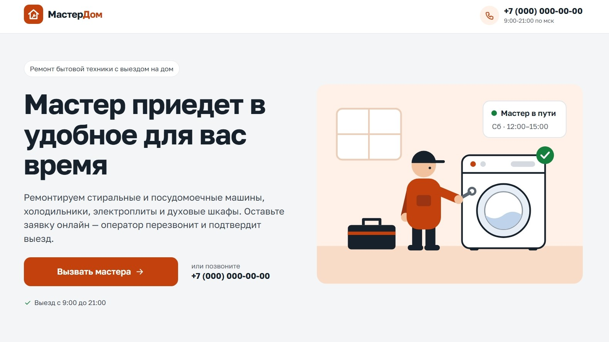
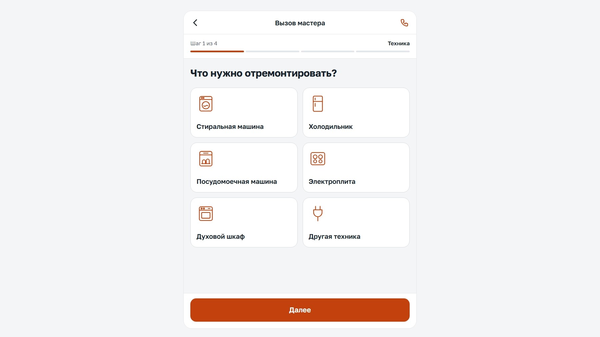
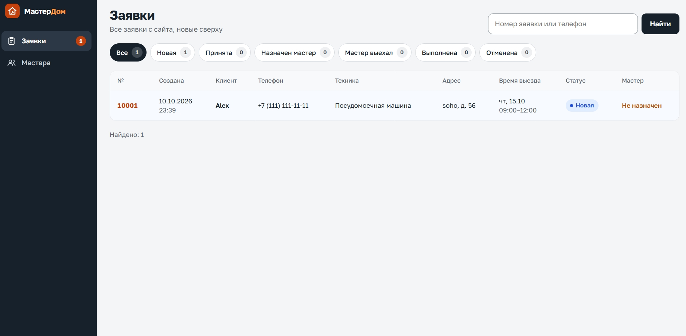

# Вызов мастера

Сервис онлайн-заявок на ремонт бытовой техники с выездом мастера на дом и админ-панель для оператора.



## Возможности

**Для клиента** — заявка с телефона за 4 шага: техника и неисправность → адрес → дата и интервал выезда → контакты. Перед отправкой — экран проверки, после — номер заявки.

**Для оператора** (`/admin`):

- список заявок с фильтром по статусу и поиском по номеру или телефону;
- карточка заявки: смена статуса, назначение мастера с подсказками по профилю и рабочим дням, перенос выезда, внутренние комментарии, история изменений;
- справочник мастеров: специализации, рабочие дни, доступность.

| Заявка                     | Админ-панель                            |
| -------------------------- | --------------------------------------- |
|  |  |

## Стек

Next.js 16 (App Router, Server Actions) · React 19 · TypeScript · PostgreSQL 17 · Prisma 6 · Zod · Docker

## Быстрый старт

```bash
cp .env.example .env   # заполните POSTGRES_PASSWORD, SESSION_SECRET, ADMIN_EMAIL, ADMIN_PASSWORD
docker compose up -d --build
```

Сайт — http://localhost:3000, админка — http://localhost:3000/admin. Миграции, справочники и первый администратор создаются автоматически при старте.

### Без Docker

Нужны Node.js 22+ и PostgreSQL, в `.env` — `DATABASE_URL` на вашу базу.

```bash
npm install
npm run db:migrate
npm run db:seed
npm run dev
```

## Скрипты

| Команда                                    | Что делает                              |
| ------------------------------------------ | --------------------------------------- |
| `npm run dev`                              | Dev-сервер                              |
| `npm run build` / `npm start`              | Production-сборка и запуск              |
| `npm run check`                            | Типы + ESLint + Prettier                |
| `npm run admin:create -- <email> <пароль>` | Создать администратора / сменить пароль |

## Структура

```
src/
  app/          маршруты: (site) — публичные страницы, order — форма заявки, admin — панель оператора
  server/       только сервер: env, БД, авторизация; data/ — запросы к БД
  lib/          общий код: константы, даты, телефон, форматирование
  components/   общие UI-компоненты
prisma/         схема, миграции, начальные данные
```